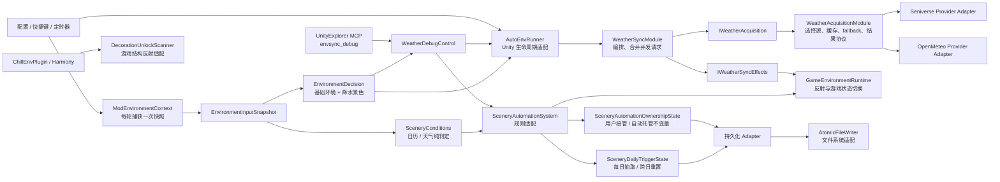

# RealTimeWeatherMod 架构

主插件采用“Unity-free 逻辑深模块 + 游戏适配层”。同步策略、缓存协议和状态不变量可在不加载游戏程序集的情况下测试；Unity 生命周期、Harmony、反射、文件 IO 和网络请求留在边缘。



## 目录约定：`Pure/` 是编译器强制的边界

```
RealTimeWeatherMod/
  Pure/          Unity-free 逻辑，零 Unity / BepInEx / 游戏程序集引用
    Core/ Models/ Services/
  Core/ Services/ Patches/   Unity / Harmony / 反射 / IO 边缘
```

两个 csproj 都以 **通配符** 引入 `Pure\**\*.cs`，不再手工维护文件清单：

- `RealTimeWeather.csproj` 把它编进同一个 `RealTimeWeatherMod.dll`，发布产物不变（仍是单个 DLL）。
- `RealTimeWeatherMod.Tests.csproj` 以 net9.0 编译同一批文件，且**不引用任何 Unity/BepInEx/游戏程序集**；两个仅依赖 BCL、可独立测试的边缘适配器采用显式文件项加入测试项目。

因此编译器会保证两条结构不变量：新增 Pure 模块自动进入两个项目的**编译面**；在 `Pure/` 下写
`using UnityEngine` 会立刻让测试项目编译失败。它不证明每个文件已有行为测试，也不把“无 Unity 引用”
等同于“无副作用”。反射、文件 IO 或 Unity 适配代码放到 `Core/`、`Services/` 或 `Patches/`，并在主
csproj 中显式列出。

## 模块边界

- `EnvironmentDecision.Resolve(policy, snapshot)` 是「此刻环境应该是什么」的唯一外部入口：常规同步、启动同步和 `envsync_debug`
  的期望值都从同一个调用取基础环境与降水景色。它用 mod 自有的 `ModEnvironment`
  枚举表达结果，与游戏 `EnvironmentType` 的转换只发生在 `ModEnvironmentMap`——这正是它能脱离
  Unity 被测试的原因。新增或修改天气 code 分类规则只改这一个文件。
  决策同时按规范化天气代码提供 `WeatherVisual` 的云量、室内减光和雾感目标；可用的平滑表现选择时间底色，关闭或不兼容时使用原有 Cloudy 替换。Open-Meteo 的云天等级与雾代码先在源 Adapter 中规范化。
  `DaylightSchedule` 按绝对时刻计算太阳轨道相位、白天与黄昏进度及跨午夜的深夜亮度曲线，`DaylightPresentation` 分别维护时间对齐和三个天气通道的淡入淡出；室内减光作用于实时主光、太阳阴影和工作后处理配置，雾感只额外控制天气过滤与雾密度，不将第三套光照贴图叠到时段混合上；
  决策另按天气代码给出 `PrecipitationVisual` 雨量与雷电权重（只需天气同步）；`PrecipitationPresentation` 负责 6 秒淡入淡出，Unity 侧 `PrecipitationController` 只缩放原生雨景实例的粒子参数，窗景选择仍由 `Scenery` 决定。
  `TimeTransitionController` 统一管理接管与释放，COZY、灯光和后处理写入仍留在渲染适配器中。太阳的世界空间方向由场景正午主光标定，天空圆盘与室内投影共用该方向，地平线下保留无太阳阴影的晨昏及夜间补光。COZY 雾层、云层通过可恢复的 Renderer 属性块保留原生黄昏的晚霞构图，完整黄昏达到原生亮度峰值。
- `ModEnvironmentContext.Capture()` 是入口级读取，不是访问器：每轮同步/规则求值只调用一次，
  把得到的 `EnvironmentInputSnapshot` 沿调用链传下去。逐条规则各自 Capture 会让真实时钟在中途
  推进，同一轮里的规则可能对「现在」产生分歧。天气获取完成后，`WeatherSyncModule` 通过
  `WithWeather` 生成同一时刻的新快照；`WeatherSyncResult.Weather` 直接从该快照读取，不维护第二份值。
- `SceneryConditions` 承载彩蛋规则的日历与天气判定（纯函数）；抽取状态、所有权和 Unity 调用留在
  `SceneryAutomationSystem`。
- `WeatherAcquisitionModule` 的外部接口是 `IWeatherAcquisition`。调用方只处理 `Fresh`、`Cache`、
  `StaleFallback` 或失败结果。Adapter **按 `Name` 精确匹配**选择，匹配不到时落到构造时指定的默认源；
  任何 Adapter 都不得声明「不是别人就是我」，那会让注册顺序变成隐式契约。
  Adapter 之间共享的 GET→解析协议（超时、传输失败、空响应、解析异常）在 `ProviderJsonRequest`，
  各 Adapter 只剩 URL 拼装和 payload 解析。
- 当前彩蛋状态、所有权及其持久化都在 Unity 主线程运行（Harmony 回调、MonoBehaviour、
  以及经 `MainThreadDispatcher` 的 MCP 调试桥），因此现有实现不需要锁；新增跨线程入口必须先派发
  回主线程，若未来确需并发访问则重新设计同步边界。
  `ManagedSnapshot()` 之类的拷贝是为了「边遍历边修改」，不是为了线程安全。
- `WeatherSyncModule` 同时服务启动同步和常规定时同步，负责请求合并、获取决策、UI/环境/日出日落副作用顺序及下次调度。它不引用 Unity 类型。
- `AutoEnvRunner` 负责协程和游戏生命周期；`GameEnvironmentRuntime` 集中封装环境控制器、EnvironmentUI、窗景状态相关的反射字段与切换 fallback。其他反射（例如装饰解锁扫描）留在各自命名明确的边缘适配器中。
- `SceneryAutomationSystem` 保留规则求值和 Unity 调用。所有权冲突及每日随机状态分别由两个小型状态模块维护，Harmony 只通过单一用户事件入口写入。
  五个概率彩蛋（含蓝蝶）统一存放在 `SceneryDailyTriggerState` 的同一张表里；蓝蝶的唯一差异是
  「有持续时长、按 20 分钟分段重抽」，由 `TryRollRecurring` / `IsActiveWithin` 表达，
  而不是另立一组字段。持久化按 `SceneryDailyTriggerState.All` 遍历，新增彩蛋无需改读写分支。
- `WeatherDebugControl` 和 MCP Bridge 复用正式同步入口，调试验证不会维护第二套环境应用逻辑。

依赖方向始终从 Unity/Harmony/MCP 边缘指向 Unity-free 逻辑模块。新增天气源应实现 Provider Adapter；环境控制相关的游戏版本兼容逻辑放入 `GameEnvironmentRuntime`，其他反射知识放入专用边缘适配器；不要让调用方重新散落缓存标志、反射字段或所有权集合。

## 验证层次

以下说明各层能证明什么；具体执行范围遵循根目录 AGENTS.md，不是每次改动的必跑清单。

- `RealTimeWeatherMod.Tests`：纯逻辑用例验证获取结果协议、同步编排、环境决策、彩蛋日历/天气条件、调试场景、所有权和每日触发状态。`Pure/` 通配符保证所有文件参与无 Unity 编译，但不据此声明行为覆盖率。
- 主项目编译：验证 .NET Framework、Unity 和游戏程序集边界。
- `envsync_debug`：在实际游戏进程中写入确定性天气/时间/日出日落，并比较期望状态与实际控制器状态。
